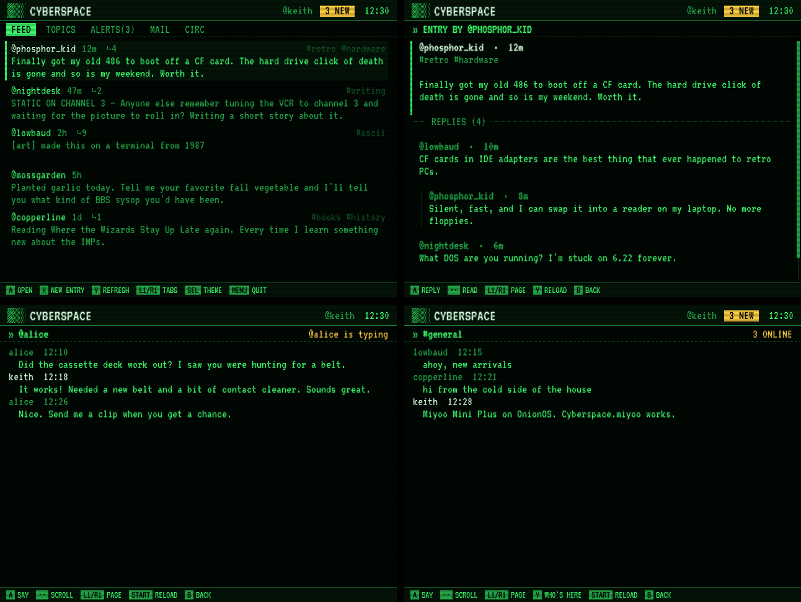

# Cyberspace.miyoo

A handheld terminal for [cyberspace.online](https://cyberspace.online), the text-only social network, on OnionOS (Miyoo Mini Plus).

**Created by Claude**, Anthropic's AI model, for snyderman3000. Released with the blessing of Cyberspace's developer.



- Read your feed, browse topics, and open entries with threaded replies
- Check alerts and post entries and replies with an on-screen keyboard
- C-Mail (private messages) and cIRC (chat rooms), updating live
- Three themes like the website: cyber, c64 and vt320

Cyberspace.miyoo is an independent client, not made by Cyberspace, so please report bugs here rather than to them. It follows the API terms: a personal client one person drives by hand, with no bots and no scraping. The API shapes come from the [API reference](https://github.com/ArmadilloBrillo/cyber-tui/blob/dev/docs/00-latest-api-reference.md) documented by the MIT-licensed [cyber-tui](https://github.com/ArmadilloBrillo/cyber-tui).

## Install

Get it from [Mixtape](https://github.com/snyderman3000/mixtape) on the device (APPS tab), or download the zip from [Releases](https://github.com/snyderman3000/Cyberspace.miyoo/releases), copy its `App` folder to the root of your SD card, and open **Apps → Cyberspace.miyoo**. You need a Cyberspace account with a verified email.

Install steps, controls and file locations are in [`package/Cyberspace.miyoo/README.txt`](package/Cyberspace.miyoo/README.txt).

Used the prototype under its old name, Dialup? The first launch copies your login, drafts and settings from `App/Dialup/data`, after which you can delete `App/Dialup`.

## Build

```sh
./build.sh            # tests, ARMv7 build, dist/Cyberspace.miyoo-v<version>-OnionOS.zip
go run . -shot feed   # render a demo screen to shot.png
                      # scenes: login dial feed topics alerts post art compose editor mail dm rooms room users confirm
```

Pure Go with no cgo. It draws straight to `/dev/fb0` and reads `/dev/input/event0`.

## License

MIT. VT323 font: SIL OFL 1.1. See `package/Cyberspace.miyoo/licenses/`.
